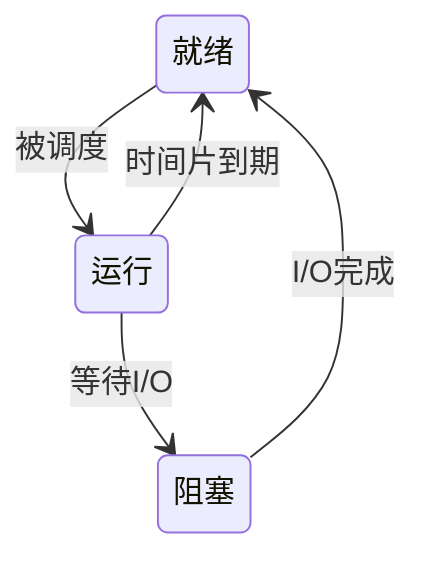

# 进程与线程：完整示范

以下考点、学生回答和路径均为合成示例，不代表真实课堂要求或真实学习效果。只在演示/测试时使用模拟回答；实际教学须等待学生作答。假设用户要求：用极速备考模式，20 分钟复习进程与线程，没有讲义，仅聊天。

## 范围与题目

使用经典三状态模型与普通共享地址空间的线程模型，不包含挂起态、具体操作系统调度细节或协程。每点来源标为“本文件示例范围”，考试权重未知；同步仅涉及非原子加法，不扩展信号量算法。

| ID | 示例考点及目标 | 前置 |
|---|---|---|
| P1 | 区分程序与进程；解释同一程序的多个执行实例 | 无 |
| P2 | 区分就绪、运行、阻塞，判断事件引起的转换 | P1 |
| P3 | 区分线程共享资源与各自执行上下文 | P1 |
| P4 | 分析共享变量读改写交错，识别丢失更新 | P3 |

第一轮导师：声明示例范围与 20 分钟预算，直接给以下四题；暂不展示后文答案。

- D1（P1）：a. 用自己的话区分磁盘上的程序和正在执行的进程。b. 同一个程序启动两个普通独立进程，就必然共享所有可写变量吗？纠正这个说法并说明理由。
- D2（P2）：a. 就绪与阻塞都没在 CPU 上执行，差别是什么？b. 单 CPU 下 A 等待磁盘，磁盘完成时 B 正运行。有人说 A 立即从阻塞变为运行，请改正并解释。
- D3（P3）：a. 同一进程的两个普通线程通常共享哪些内存，各自保留哪些执行状态？b. T1 修改一个堆对象后，T2 是否需要跨进程通信才能访问该对象？指出两线程调用栈的关系。
- D4（P4）：a. 将非原子的 x=x+1 拆为读、加、写，解释两个线程都加一次为何可能只增加 1。b. x 初始为 5，两线程都先读出 5，再分别计算并写回，最终值多少？如何保证两次增量都保留？

## 第一轮作答与路由

模拟学生一次回答：D1a 程序是静态指令，进程是执行实例；D1b 不必然，各自有地址空间，显式共享另论。D2a 就绪差 CPU，阻塞等事件；D2b 磁盘完成就直接运行。D3a 共享代码、堆和全局数据，各有栈、寄存器和程序计数器；D3b 不需要 IPC，地址空间相同，但各自调用栈不同。D4a CPU 会依次做完整加法，不会丢；D4b 最终 7，不需要保护。

导师评分：P1 的解释和改错均正确，本轮可跳过；P3 的解释和场景应用正确，本轮可跳过。仅据这些证据可支持 Level 3，不宣称长期迁移。P2 的事件转换有误，P4 的原子性假设有误，均为薄弱。诊断覆盖 4/4，初始达标 2/4。教学路径直接进入 P2，然后 P4，不重讲 P1/P3，不额外问是否同意路径。

## 第二、三轮：P2 补弱与验证

第二轮导师短讲：就绪表示运行所需条件已满足，只缺 CPU；阻塞表示还在等待 I/O 等事件。磁盘完成只消除了等待原因，A 先进入就绪队列，是否马上获得 CPU 取决于调度。即使抢占策略随后让 A 执行，也应区分事件完成与调度这两个逻辑步骤。

针对练习 E2：A 发起磁盘请求并等待，完成后尚未被调度。写出状态序列。

模拟学生：运行、阻塞、就绪。导师记录练习正确，尚不单凭练习通过。

第三轮导师变式 V2：C 正运行时用完时间片；D 正等待键盘输入。二者是否都进入就绪？若输入到达但 CPU 忙，D 此时是什么状态？解释两种等待的区别。

模拟学生：C 进入就绪；D 在输入到达前仍阻塞，输入到达后进入就绪。C 缺 CPU，D 原先缺事件。导师：独立解释与变式均通过，P2 标记补弱后通过。

## 第四、五轮：P4 补弱与验证

第四轮导师短讲：共享地址空间让两个线程看到同一个 x，却不保证一次加法不可分割。在题目指定的非原子读改写模型下，两线程可能先读到同一个旧值，各自加一后写回同一个新值，覆盖彼此的更新。需要用覆盖整个读改写过程的互斥保护或合适的原子加法，不能只保护最后写回。

| 顺序 | T1 | T2 | 共享 x |
|---|---|---|---|
| 1 | 读 5 | — | 5 |
| 2 | — | 读 5 | 5 |
| 3 | 写 6 | — | 6 |
| 4 | — | 写 6 | 6 |

这是抽象交错模型，不是对有数据竞争的 C/C++ 程序行为的保证。

针对练习 E4：x 初始为 8，两线程都先读后写，各加一，最终值多少？指出丢失的是哪一次增量。

模拟学生：最终 9，第二次写回覆盖了相同的新值，两次增量只保留一次效果。

第五轮导师变式 V4：x 初始为 10，两线程分别执行非原子加 2 与加 3。构造一个丢失更新的交错，写出最终值，并解释为什么只锁住写回不够、应保护哪段。

模拟学生：都先读 10，T1 写 12 后 T2 写 13，最终 13；只锁写回仍会使用旧读数，应保护完整读、改、写，串行后为 15。导师：P4 补弱后通过，停止新增题目，直接收束。

## 结束记录示例

本轮 P1/P3 凭 D1/D3 两种独立证据跳过，P2 经 D2→E2→V2、P4 经 D4→E4→V4 补弱后通过；均无提示。保留 D2 的直接运行误解和 D4 的原子性误解。诊断覆盖 4/4，本轮达标 4/4，未测 0；结论仅覆盖这四个示例目标。下次有真实讲义后重新核对范围，不推断已掌握整章。用户指定仅聊天，因此不生成学习文件。20 分钟为预算，未记录真实耗时。

若 V2/V4 答错，实际路径必须分支回到相应缺口，不能照抄此示例结尾。若时间先耗尽，报告剩余薄弱点。

## 与普通教学比较

比较使用相同四考点、相同合成学生起点及最终验证要求。普通路径是原有默认流程的一种合理实例，并非所有普通教学都必须这么长。两者都已知道学习目标，不添加多余开场轮次；轮次指需要学生回复的一次交互，最终总结不计。

普通路径可逐点执行：讲解与示例→学生微产出→导师反馈与变式→学生作答，每点两轮，共八轮。P2/P4 的错误在微产出后反馈，变式通过。该普通实例也复用回答、不另加项目，以免人为抬高基线。

| 指标 | 普通路径实例 | 极速路径实例 |
|---|---|---|
| 学习路径 | P1→P2→P3→P4，每点讲解、微产出、验证 | D1–D4→跳过 P1/P3→P2→P4 |
| 需要回复的轮次 | 8 | 5（诊断1＋两点各2） |
| 任务/主问题数 | 8 | 8（诊断4＋练习2＋变式2） |
| 诊断子问 | 无前置测验 | 8，须计入阅读与答题负担 |
| 已会点的讲解块 | 2 | 0 |
| 涉及的考点 | 4/4 | 4/4 |
| 最终有证据达标的考点 | 4/4，假设变式均通过 | 4/4，含诊断跳过证据 |
| 真实耗时/留存效果 | 未测量 | 未测量 |

设计轨迹中回复轮次减少 3/8（37.5%），但主问题数没有减少。减少的无效步骤是已会点讲解及重复基础训练；能否减少真实学习时间须用验收文件中的配对实验测量。对零基础学生，诊断可能增加成本，不承诺人人提速。
